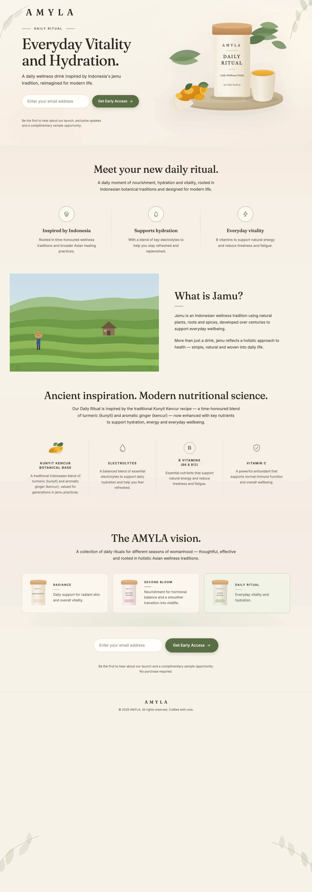

# AMYLA — Daily Ritual Landing Page

A pixel-faithful, fully responsive recreation of the **AMYLA Daily Ritual** wellness landing page — built as a static site with zero build step.



## ✨ Features

- **Faithful design recreation** — warm cream palette, Fraunces display serif, olive-green CTAs, decorative botanical corner motifs
- **Optimized WebP imagery** — all photos cropped from the source design and converted to WebP for fast loading
- **Fully working waitlist demo** — client-side email validation, localStorage persistence, success states, and toast feedback on both forms
- **Responsive** — desktop, tablet, and mobile layouts with graceful stacking
- **Accessible** — semantic HTML, ARIA live regions, focus states, `prefers-reduced-motion` support, screen-reader-only labels
- **Fast** — single HTML + CSS + JS, Google Fonts, no frameworks

## 🚀 Live Demo

**https://dagmawi-yoseph.github.io/amyla-daily-ritual/**

Demo created by [Dagm](https://dagm.dev)

## 🛠️ Run Locally

No build tools required — open directly or serve statically:

```bash
# Option 1: open in browser
open index.html

# Option 2: local server
python3 -m http.server 8080
# → http://localhost:8080
```

## 📁 Structure

```
amyla-daily-ritual/
├── index.html        # Full page markup
├── css/styles.css    # Design system, layout, responsive rules
├── js/main.js        # Waitlist form logic (localStorage demo)
├── assets/           # WebP photos + preview
└── README.md
```

## 🎨 Design Tokens

| Token | Value |
|-------|-------|
| Background | `#f7f1e8` cream |
| Ink | `#2c2a24` |
| Primary green | `#5a6e45` |
| Display font | Fraunces |
| Body font | Inter |
| Radius | `999px` pills |

## 📬 Waitlist Demo

Both "Get Early Access" forms validate the email client-side, store signups in `localStorage` under `amyla_waitlist`, and show inline + toast confirmation. Swap `js/main.js` `saveEntry()` for a real API call (Formspree, Buttondown, your backend) when you're ready to go live.

## 📄 License

Demo / portfolio project. Design © AMYLA concept.
